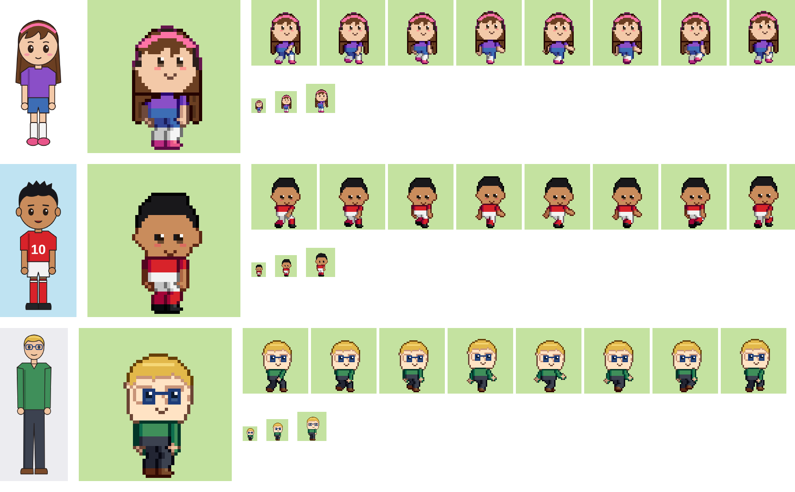

# PixelForja

Convierte una imagen de cuerpo entero (un dibujo, una ilustración, un avatar o un pixel art) en un personaje de pixel art animado, listo para juegos. Sin IA y sin servidor. La imagen nunca sale del equipo.

Estado: **Fase 0**, prototipo del flujo completo. Ver [docs/PLAN.md](docs/PLAN.md).



## Correr el estudio

```bash
npm install
npm run dev          # abre http://localhost:5173
```

## Generar en lote

```bash
npm run forja -- build samples/gabo.png --out out/gabo
npm run forja -- build mi_dibujo.png --head 120,90,180,200 --eyes 160,250,240,250 --sizes 48
npm run forja -- render out/gabo/gabo.ficha.json --out out/gabo2
```

Genera la ficha, las hojas PNG + JSON por tamaño, el preajuste de Fútbol Familia GG, los GIF y la tabla de calidad.

## Pruebas

```bash
npm test             # Vitest: motor, exportadores e imágenes doradas
npm run e2e          # Playwright: el estudio en computadora y teléfono
UPDATE_GOLDEN=1 npm test   # aceptar a propósito un cambio visual
```

## Publicar

`netlify.toml` ya está listo: conecta el repo en Netlify y publica `dist`.
