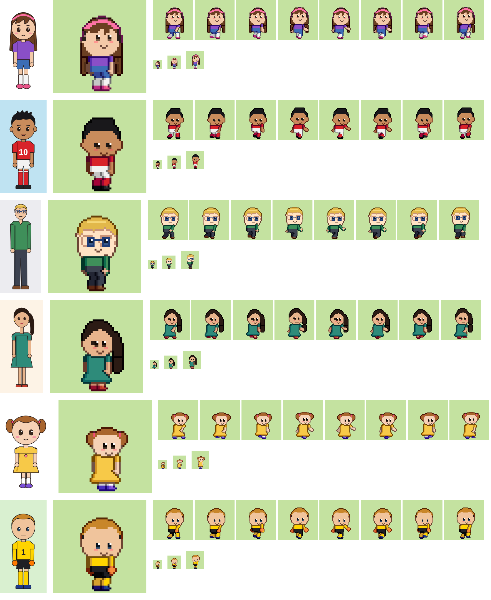

# PixelForja

Creador de personajes de pixel art animados y listos para juegos. Armas el personaje pieza por pieza
(cuerpo, edad, cara, 86 peinados dibujados a mano, barba, lentes, gorros, ropa y colores) y sale animado
con 75 movimientos en cuatro direcciones. También convierte dibujos de cuerpo entero y toma los colores
de una foto. Sin IA y sin servidor: todo corre en tu equipo.



- 75 animaciones humanas: básicas, las 33 de Fútbol Familia GG, portero, básquet, vóley, tenis,
  béisbol, natación, atletismo, artes marciales, skate, bici y RPG.
- 10 animaciones de animal (boxer, perro, mapache, gato).
- Vista lateral y 4 direcciones tipo RPG. Tamaños de 32, 48 y 64 px. Cuerpo chibi, juvenil o realista.
- Modo busto para selfies y fotos: cara, barba, cejas, camisa y estampado. El resto del cuerpo va por defecto.
- Taller RPG estilo Diablo: clases de héroe, armaduras, 13 armas, 12 habilidades, 13 enemigos, poderes de 8 elementos y 45 objetos con rarezas.
- Creador de avatar con 86 peinados y piezas dibujadas a mano del proyecto LPC (con créditos automáticos al exportar).
- Editor de poses, galería, "sorpréndeme" y estudio en español e inglés.
- Exporta hoja PNG + JSON (Phaser), preajuste de Fútbol Familia GG, Aseprite, Godot 4, Unity,
  PNG por cuadro, GIF y la ficha del personaje.

Detalle, decisiones y estado: [docs/PLAN.md](docs/PLAN.md). Cómo usar los sprites en Phaser, Expo, Unity y Godot: [docs/USO.md](docs/USO.md).

## Correr el estudio

```bash
npm install
npm run dev          # http://localhost:5173
```

## Generar en lote

```bash
npm run forja -- build samples/gabo.png --out out/gabo --export sheet,ffgg,godot,unity,aseprite,gif
npm run forja -- build samples/thor.png --animal boxer --out out/thor
npm run forja -- build mi_dibujo.png --preset juvenil --anims football,rpg --views side,front,back,left
npm run forja -- render out/gabo/gabo.ficha.json --out out/gabo2 --anims all
npx tsx scripts/personaje.ts samples/selfie.png out/selfie selfie   # comparación, GIF, hoja del juego y ficha
```

## Kit a medida para un juego

```bash
npm run kit-a-medida -- out/kit --config docs/ejemplos/nekketsu/kit.config.json
```

El juego describe en un `kit.config.json` qué personajes, packs de animaciones, armas, animales y fuentes necesita,
y sale el kit con su `manifest.json` y los atlas para Phaser. `visor.html` lo recorre con cajas, manos y eventos
dibujados. Detalle: [docs/KIT_A_MEDIDA.md](docs/KIT_A_MEDIDA.md).

El kit también trae el catálogo general de efectos (polvo, chispas de golpe, reacciones de anime, agua, fiesta, clima,
técnicas y pantalla completa) y los sonidos que ya tiene el motor. Los efectos se ven en el estudio, en Inicio,
**Efectos del juego**. Detalle: [docs/EFECTOS.md](docs/EFECTOS.md).

También trae la interfaz retro (logo desde el nombre del juego, caja de diálogo, paneles por equipo, barras,
banners, controles táctiles, minimapa y marcador) y el audio: marcha de banda, tema con đàn tranh, tema de pelea,
golpes, público y voces en blips, con `audio/escuchar.html` para oírlo todo. Detalle: [docs/INTERFAZ.md](docs/INTERFAZ.md)
y [docs/AUDIO.md](docs/AUDIO.md).

## Pruebas

```bash
npm test                   # Vitest: motor, calidad de todas las animaciones, exportadores, imágenes doradas
npm run e2e                # Playwright: el estudio en computadora y teléfono
npm run entregables        # hojas, GIF y tabla de calidad en out/entregables
UPDATE_GOLDEN=1 npm test   # aceptar a propósito un cambio visual
```

## Publicar

`netlify.toml` ya está listo: conecta el repo en Netlify y publica `dist`.
